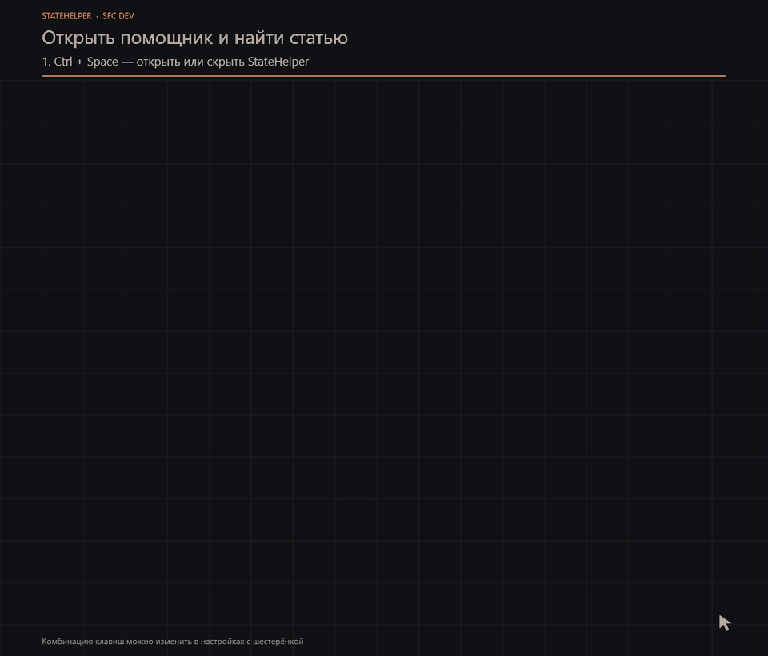
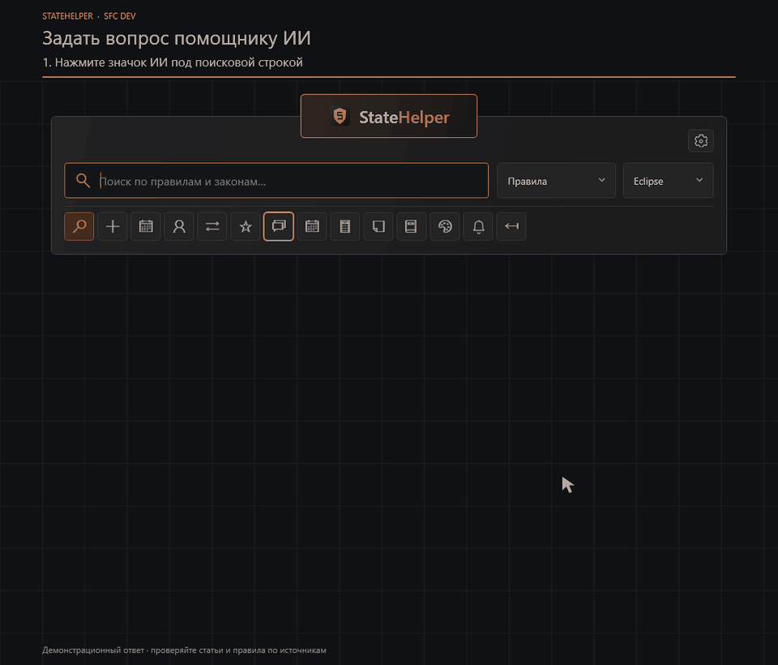
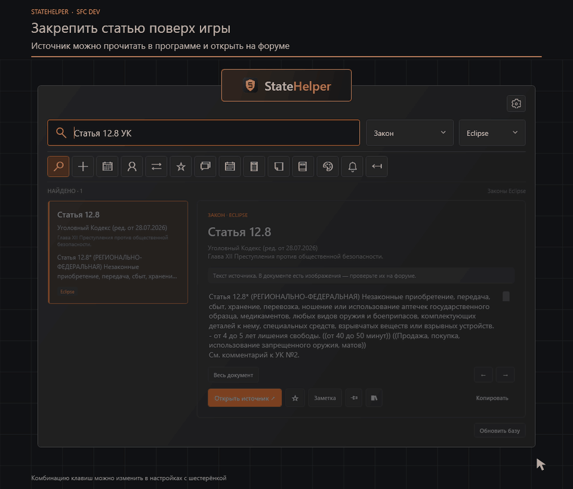

# StateHelper

**Открытая бета от SFC Dev.** Помощник для игроков GTA5RP: правила и законы всех 13 серверов, Wiki, ИИ, избранное и статьи поверх игры.

[Скачать StateHelper-Setup.exe](https://github.com/SFCDevStudio/GTA5RP_assist/releases/latest/download/StateHelper-Setup.exe) · [Portable ZIP](https://github.com/SFCDevStudio/GTA5RP_assist/releases/latest/download/StateHelper-Portable-win-x64.zip) · [История выпусков](https://github.com/SFCDevStudio/GTA5RP_assist/releases)

Windows x64. Обновления доступны через приложение. При первом запуске ознакомьтесь с политиками и коротким обучением. Через «Настройки» можно изменить горячую клавишу, включить автозапуск и снова открыть обучение.

## Как пользоваться — GIF-инструкции

Ролики показывают интерфейс StateHelper 0.12.4. Подписи сверху и оранжевая рамка подсказывают следующий шаг.

### 1. Открыть помощник и найти статью

**Ctrl + Space** открывает и скрывает окно. Выберите «Правила» или «Закон», укажите сервер и начните вводить запрос. Для точного поиска используйте номер и сокращение кодекса, например **«Статья 12.8 УК»**. Кнопка «Открыть источник» ведёт к оригиналу на форуме.

[Открыть GIF отдельно](media/tutorials/01-search.gif)

В игре используйте оконный или безрамочный режим, чтобы видеть помощник поверх неё. Горячая клавиша меняется через шестерёнку.

### 2. Задать вопрос ИИ и проверить источники

Откройте раздел **«ИИ»**, опишите ситуацию и нажмите **Enter**. Перед первым запросом прочитайте отдельное согласие. Ответ появится справа; нажатие на название источника откроет нужный фрагмент. Для вопросов на другие темы можно выбрать «Любая тема».

[Открыть GIF отдельно](media/tutorials/02-ai.gif)

**В ролике показан демонстрационный ответ.** Реальный ответ зависит от вопроса и найденных источников. Сверяйте вывод с оригиналом статьи или правила.

Для ИИ нужен интернет. Вопрос обрабатывается Gemini, а при сбое — резервным ИИ Cloudflare после согласия. История предыдущих вопросов в новый запрос не включается. Личный лимит — **30 подготовленных ответов в сутки на установку**; общий защитный предел сервиса — 300 обращений в сутки для всех установок. Сброс происходит в 00:00 UTC; остаток и местное время сброса видны в приложении. Обычный поиск доступен и при исчерпании лимита.

### 3. Сохранить и закрепить статью поверх игры

**Звёздочка** добавляет статью в избранное. **Булавка** открывает отдельную карточку. После скрытия главного окна карточка остаётся поверх игры. Её можно перемещать, менять размер и прозрачность; несколько статей можно объединить в группу и открыть две рядом.

[Открыть GIF отдельно](media/tutorials/03-pin.gif)

Крестик скрывает карточку; открыть её снова можно через **«Избранное → Закреплённые статьи и группы»**. Текст, названия и группы сохраняются на компьютере.

## Другие возможности

- «Транспорт», «Карта», «Недвижимость» и другие категории открывают настоящий GTA5RP Wiki внутри программы. Для Wiki нужен интернет; выбор сервера находится в самой карте, когда он требуется.
- Калькулятор считает статьи законов, например **«12.8 + 17.1»**, и пункты правил, например **«DM + PG»** или **«6.9 + 5.3»**. Деморган, мут, бан и блокировки имеют отдельные минимумы и максимумы. Если сокращение неоднозначно, выберите пункт. Условия проверяйте в оригинале.
- Помощник принимает просьбы посчитать наказание, например **«Посчитай деморган за DM и 5.3»**. Такой расчёт выполняется на компьютере по источникам и не расходует лимит ИИ.
- Окно мягко проявляется и приближается при открытии; оранжевая плашка коротко подсвечивается. Быстрые нажатия горячей клавиши не оставляют зависших эффектов, а поиск доступен сразу.
- В **«Оформлении»** есть режим **«Прозрачнее без фокуса»**. При переходе в игру окно плавно становится прозрачнее, при возвращении восстанавливает вашу настройку. Можно выбрать степень или отключить режим.
- В «Профилях» выберите сервер и фракцию. Для официальных дней ВЗХ укажите банду или мафию. В «Мероприятиях» можно включить ДРОП и другие напоминания, задать своё время и проверить карточку. Напоминания работают при скрытом поиске; расписание само по себе не подтверждает фактическое начало события.
- В «Оформлении» меняются размер текста, размер окна и прозрачность. Личные заметки, избранное и профили можно перенести через «Перенос настроек».
- В Changelog есть история программы и вкладка Dev blog. Новые версии доступны через автообновление.

Локальный поиск правил и законов работает без интернета. Скрытие окна отменяет ожидание ИИ, приостанавливает Wiki и откладывает автоматические загрузки. Фирменный Uninstall.exe позволяет сохранить настройки для переустановки или удалить их полностью.

## Связь

Разработчик в Discord: **dominic9090**. Студия **[SFC Dev](https://discord.gg/RZ3kJJGntS)**.

Неофициальный справочник; программа не связана с администрацией GTA5RP. Правила на форуме и решения администрации имеют приоритет.

В этом публичном репозитории размещены описание, GIF-инструкции и готовые файлы программы. Исходный код и история разработки хранятся в закрытом репозитории. После переноса GitHub начал считать скачивания новых копий файлов заново; прежние значения сохранены в [downloads-before-migration.json](downloads-before-migration.json). Счётчик файлов включает повторные скачивания и автообновления, а не число уникальных игроков.
